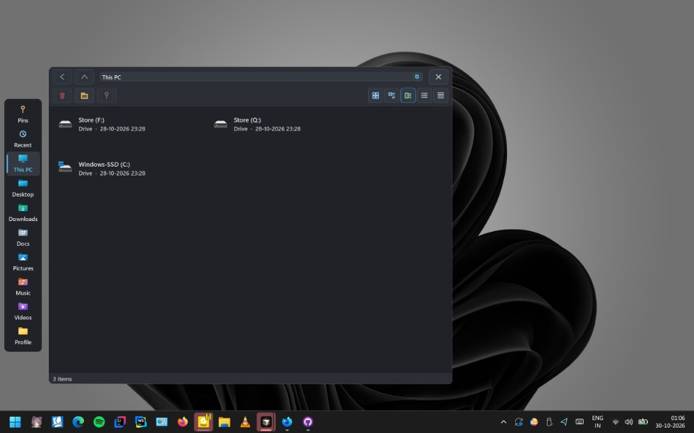

# QuickBrowse

**A file browser that lives on the left edge of your Windows desktop.**

Open This PC, Downloads, Desktop, Documents, and other everyday folders from a slim rail, then browse inside a panel that stays with it. Hover the left edge to bring it back when apps are in the way. No installer needed for standalone use. No telemetry. Runs only on your PC.

Works alongside [JumpDock](https://github.com/bhaskarsingh144/JumpDock) (top) and [QuickView](https://github.com/bhaskarsingh144/QuickView) (right).


---

## Screenshots



---

## Features

### Left-edge rail

- Quick jumps to **This PC**, **Downloads**, **Desktop**, **Documents**, **Pictures**, and your profile folder
- **Pins** for folders you use all the time
- **Recent** files and folders from Windows Recent
- Stays out of the way while you work; **hover the left edge** to show it again

### Folder browsing

- Open a place or pin and browse files in a panel next to the rail
- Move up folders, change how items look (list or tiles), and keep the path in view
- Right-click items for familiar Windows open / copy / delete style actions

### Desktop fit

- Sits beside your other windows, not inside Explorer
- Hides when you are using apps; comes back on left-edge hover
- On an empty desktop it can sit quietly on the left
- Plays nicely with JumpDock on top and QuickView on the right

---

## Also in this family

| App | Edge | What it does |
| --- | --- | --- |
| [**JumpDock**](https://github.com/bhaskarsingh144/JumpDock) | Top | App dock and jump lists |
| [**QuickView**](https://github.com/bhaskarsingh144/QuickView) | Right | System monitor and quick settings |
| **QuickBrowse** | Left | Places rail and file browsing |

---

## Build and run

```powershell
.\scripts\build.ps1
.\scripts\setup-standalone.bat
```

Tests:

```powershell
.\scripts\test.ps1
```

Install for all users (run as Administrator):

```batch
.\scripts\setup.bat
```

Built with C# WinForms on .NET Framework 4.5+. No NuGet packages required.

---

## Docs

| Doc | Purpose |
| --- | --- |
| [`docs/TEST-MVP.md`](docs/TEST-MVP.md) | Manual checks to try after a build |
| [`docs/TEST-SHELL.md`](docs/TEST-SHELL.md) | Show / hide and edge hover |
| [`docs/TEST-PINS.md`](docs/TEST-PINS.md) | Pins |
| [`docs/TEST-RECENT.md`](docs/TEST-RECENT.md) | Recent |
| [`docs/TEST-CONTEXT.md`](docs/TEST-CONTEXT.md) | Right-click menus |
| [`docs/TOUCH.md`](docs/TOUCH.md) | Touch notes |
| [`CONTRIBUTING.md`](CONTRIBUTING.md) | How to contribute |

---

## License

[MIT](LICENSE) © 2026 Bhaskar Singh
